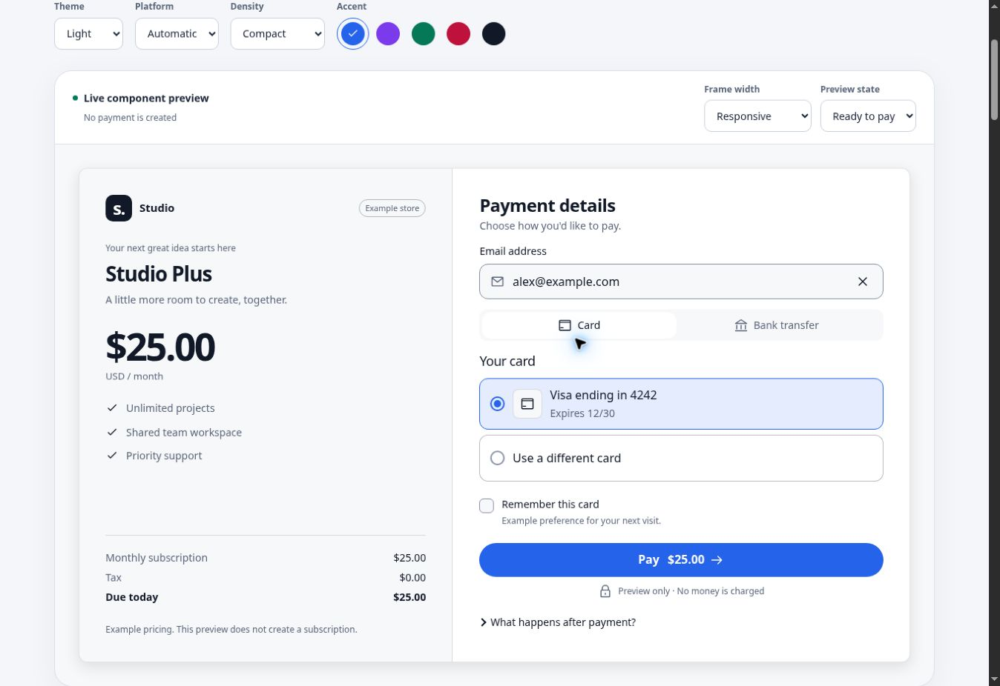

# Checkout kit

Checkout kit is a set of packages for accepting online payments. It works with Stripe, Adyen, PayPal or your own payment provider, and you write the payment flow only once.

What it does for you:

- runs the payment step by step: create the payment, send the payment details, handle extra steps (such as 3-D Secure), get the result;
- repeats a request safely if the network fails, so the shopper is not charged twice;
- restores the payment after the shopper comes back from the bank's page or reloads the tab;
- checks the real payment status with the provider instead of trusting what the browser says.

What stays with you:

- **your interface.** The engine draws nothing. Use your own components or the optional `@checkout-kit/ui` package;
- **your server.** It knows the prices, keeps the secret keys and decides whether an order is paid.

New to payments? Read the [glossary](./docs/glossary.md) first. It explains words like "intent", "instrument", "redirect" and "idempotency key".

Documentation: [English](https://pavel-labs.github.io/checkout-kit/) · [Русский](https://pavel-labs.github.io/checkout-kit/ru/). A good first page is the [package list](https://pavel-labs.github.io/checkout-kit/packages.html).

## Try it in two minutes

You need Node.js 24 and npm.

```bash
npm ci
npm run dev:integration
```

Open <http://localhost:5173> and choose **Stripe adapter**, **Adyen adapter** or **PayPal adapter**. A local test server starts on port 4000. You do not need an account or API keys: the providers are replaced by a local **simulator**.

For Stripe and Adyen, type one of these values into the payment token field:

| Value                | What happens                                |
| -------------------- | ------------------------------------------- |
| `pm_mock_approve`    | The payment succeeds.                       |
| `pm_mock_decline`    | The bank declines the payment.              |
| `pm_mock_challenge`  | The bank asks for an extra check (3DS).     |
| `pm_mock_processing` | The payment stays "processing" for a while. |

PayPal opens a test approval page. When a payment leaves the app for another page and comes back, the app restores it from session storage.

The simulator only imitates the providers. To call the real test APIs (sandbox) of Stripe, Adyen or PayPal, follow the [server guide](./examples/server/README.md).

## Packages

| Package                                              | What it is for                                                                     |
| ---------------------------------------------------- | ---------------------------------------------------------------------------------- |
| `@checkout-kit/core`                                 | The payment engine. No React and no browser code. Also types and an HTTP client.   |
| `@checkout-kit/runtime-browser`                      | Browser helpers: redirects, iframes, provider SDKs, storage, return page.          |
| `@checkout-kit/react`                                | React 19 bindings: provider component, hooks, a place to show extra steps.         |
| `@checkout-kit/ui`                                   | Optional ready-made accessible checkout components with their own styles.          |
| `@checkout-kit/provider-stripe`                      | Stripe support (PaymentIntents, Stripe.js).                                        |
| `@checkout-kit/provider-adyen`                       | Adyen support (Advanced flow, encrypted card fields, 3DS2, redirects).             |
| `@checkout-kit/provider-paypal`                      | PayPal support (Orders, approval, checked capture).                                |
| `@checkout-kit/webview-bridge`                       | Messages between a native mobile app and the checkout page inside it.              |
| `@checkout-kit/testing`, `@checkout-kit/conformance` | A fake payment API for tests, and a ready test suite for your own provider plugin. |

There are six more `provider-*` packages. They are **examples** of common payment protocols (a JSON API, a bank with forms, a payment page, hosted fields, a wallet, a bank transfer). They work only with the local simulator. Use them as templates when you write support for your own provider; they do not connect to any real bank.

## When to use it

Use checkout kit when you want one payment flow for several providers, or when you need reliable retries, 3-D Secure, redirects and recovery after a page reload. You can add `observeCheckout` to collect simple metrics without sending payment data to analytics.

If you only need one provider's ready payment page, that provider's own SDK may be enough.

Before real payments, read the [production guide](./docs/production.md). It explains what checkout kit guarantees and what your server must do. A few safety rules are on by default:

- action addresses must use HTTPS;
- provider scripts load only from addresses you allow;
- raw card data for Adyen is off unless you turn it on.

These defaults and the telemetry are in the source code now and will ship in the next release. The older `0.2.0` bundle does not have them.

## Install in your project

1. Download `checkout-kit-0.2.0.tar.gz` from [GitHub Releases](https://github.com/pavel-labs/checkout-kit/releases/tag/v0.2.0) and unpack it.
2. Go to **your application's folder** and run the installer with the packages you need:

```bash
node /path/to/checkout-kit-0.2.0/install.mjs runtime-browser provider-stripe react ui
```

The installer checks each archive (SHA-512) and adds the other checkout-kit packages they need automatically. Other dependencies, such as React, are installed by npm as usual.

- Use `provider-adyen` or `provider-paypal` instead of `provider-stripe` for those providers.
- Leave out `react ui` if your app does not use React.
- `--list` shows all packages. `--dry-run` checks your choice without installing anything.
- You can also install single `.tgz` files, but install their checkout-kit dependencies in the same command.

To build packages from the current source instead, run `npm run pack:packages` in a clone of this repository and use `artifacts/packages/install.mjs`. CI uploads the same files under the name `checkout-kit-packages`. `npm run verify:consumer` checks all 16 archives in a clean project: installation, strict TypeScript, exports, a checkout run, server-side rendering and the rejection of damaged files.

About versions: bundle `0.2.0` contains `@checkout-kit/ui@0.2.0`, and the other 15 packages are `0.1.0`. Each package has its own version, and the installer picks matching archives from the manifest. This is an early release. GitHub archives need no private registry access.

About npm: publishing to the public npm registry (`registry.npmjs.org`) is being prepared, but it is not done yet. Until the packages are actually available on npm, use the archives above or build from source. The [release guide](./RELEASING.md#public-npm-publication) describes the dry run, the first scope setup and the trusted publisher settings.

## Connect it

First, set up the adapter routes on your server (see each provider's guide). Then create the browser runtime and the engine:

```ts
import { createCheckout, defineProvider } from '@checkout-kit/core'
import { createBrowserRuntime } from '@checkout-kit/runtime-browser'
import { createStripeSdkAdapter, type StripeConfig } from '@checkout-kit/provider-stripe'
import { loadStripe } from '@stripe/stripe-js/pure'

const stripe = loadStripe(yourPublishableKey)
const runtime = createBrowserRuntime({
  returnPath: '/payment/return',
  sdk: {
    adapters: [
      createStripeSdkAdapter(async () => {
        const client = await stripe
        if (!client) throw new Error('Stripe.js could not load.')
        return client
      }),
    ],
  },
})
const engine = createCheckout({
  providers: [
    defineProvider({
      id: 'stripe',
      config: { baseUrl: '/api/stripe', credentials: 'include' } satisfies StripeConfig,
      load: () => import('@checkout-kit/provider-stripe'),
    }),
  ],
  defaultProviderId: 'stripe',
  runners: runtime.runners,
  storage: runtime.storage,
  returnUrl: runtime.returnUrl,
})

// `paymentMethod` comes from Stripe Elements, not a raw card input.
const result = await engine.pay({
  input: { planId: '1id' },
  instrument: { kind: 'token', token: paymentMethod.id },
  idempotencyKey: orderAttemptId,
})
if (result.status === 'requires_action') await engine.runPendingAction()
// On /payment/return:
await engine.hydrate(runtime.readReturnParams())
```

What happens here:

1. `pay()` creates the payment and sends the card token. The card itself was collected by Stripe's own fields.
2. If the bank wants an extra step (`requires_action`), `runPendingAction()` runs it.
3. If that step took the shopper to another site, they come back to `/payment/return`. There `hydrate()` restores the payment and asks the server for the real result.

In React, wrap the screen in `CheckoutProvider`, read the state with `useCheckout()` and render `PaymentActionHost` where extra steps should appear. The [plain React example](./examples/react/App.tsx) shows the full screen: entering details, paying, processing, errors, receipt and return after a redirect.

Three rules that prevent double charges:

- **Keep the same idempotency key** while you repeat the same attempt, including when a reply was lost. A new key is allowed only after a clear decline.
- **If a payment is still processing, check its status first.** Do not start a second payment.
- **`reset()` only clears the page state.** It does not cancel a charge at the provider.

Each provider needs different routes on your server. The exact requests, responses and SDK callbacks are in the package READMEs: [Stripe](./packages/provider-stripe/README.md), [Adyen](./packages/provider-adyen/README.md), [PayPal](./packages/provider-paypal/README.md).

## How it is built

Every payment goes through the same steps: **create → confirm → extra step (if needed) → check the result → final status**.

- A **provider plugin** describes what the provider needs (for example, "open this bank page").
- A **runner** decides how to do it in the current app (an iframe, a full-page redirect, an SDK).

To support a new provider or a new kind of app, you add a plugin or a runner. The core does not change.

The core has no React or browser dependencies. Provider SDKs live in your app and on your server. Anything that comes back from the browser — return page parameters, SDK callbacks — is only a hint. It is checked against the server and never counts as proof of payment. Delivering the order, refunds and settlements are your server's job.

## Tests

CI checks types, unit and contract tests, browser tests of payments and UI, builds, package exports and installation outside this repository. All of this uses test data and local simulators. Checking with your own Stripe, Adyen or PayPal test account is a separate step that you do yourself.

The example server keeps orders in memory. For a real shop, replace it with a database and your own user login.

```bash
npm test
npm run test:e2e
npm run test:integration
npm run test:ui
npm run verify:consumer
```

See the [UI gallery](https://pavel-labs.github.io/checkout-kit/demo/gallery): a full checkout, light and dark themes, brand colors, mobile sizes and each component on its own.



## Guides

All guides are in English and Russian. There is also a generated API reference on the site.

- Glossary: [English](./docs/glossary.md) / [Русский](./docs/ru/glossary.md)
- Getting started: [English](./docs/getting-started.md) / [Русский](./docs/ru/getting-started.md)
- Architecture: [English](./docs/architecture.md) / [Русский](./docs/ru/architecture.md)
- Writing a provider: [English](./docs/plugin-authoring.md) / [Русский](./docs/ru/plugin-authoring.md)
- Browser and SDK integration: [English](./docs/integrations.md) / [Русский](./docs/ru/integrations.md)
- UI: [English](./docs/ui.md) / [Русский](./docs/ru/ui.md)
- Payment security: [English](./docs/production.md) / [Русский](./docs/ru/production.md)
- Safe telemetry: [English](./docs/observability.md) / [Русский](./docs/ru/observability.md)
- Merchant server: [English](./docs/backend.md) / [Русский](./docs/ru/backend.md)
- Mobile apps: [English](./docs/webview.md) / [Русский](./docs/ru/webview.md)

[Documentation site](https://pavel-labs.github.io/checkout-kit/) ·
[Examples](./examples/README.md) · [Release process](./RELEASING.md)

Apache-2.0. See [LICENSE](./LICENSE) and [NOTICE](./NOTICE).
