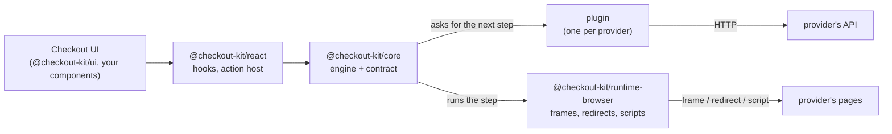
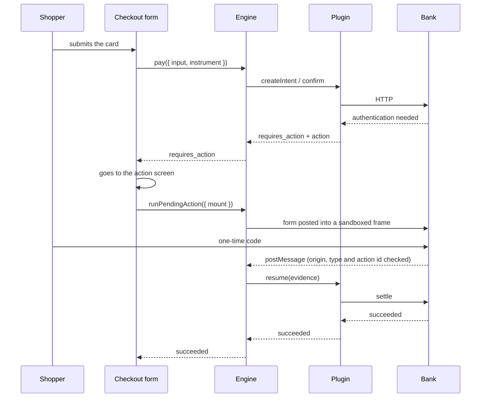
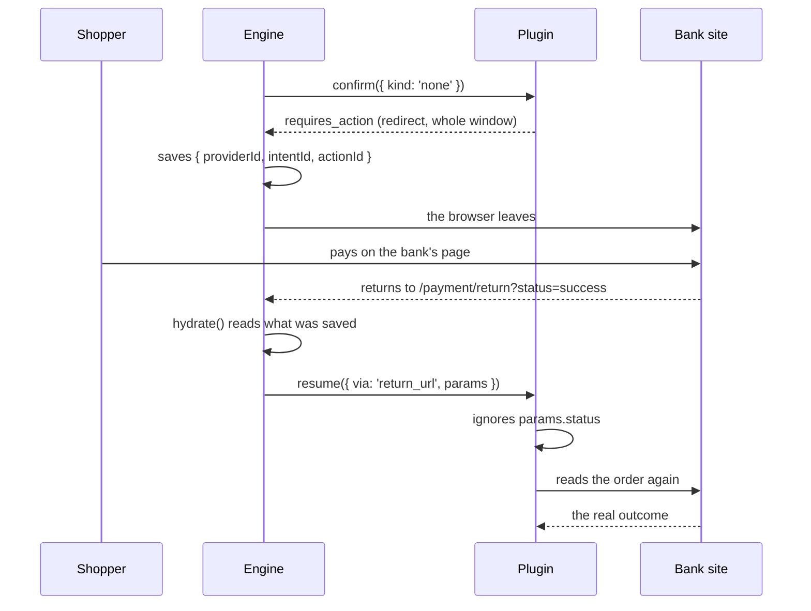

# Architecture

> Русская версия: [ru/architecture.md](./ru/architecture.md)

## The idea

Code that accepts payments contains two kinds of knowledge, and they change at very different speeds.

**The first is what a payment is.** A payment is created. The shopper gives a payment instrument (for example, a card token). Sometimes one more step is needed, such as a bank check. In the end the payment succeeded, was declined, or failed. This has not changed for decades.

**The second is how a particular provider describes all of that.** JSON or HTML forms. A status as a word or as a number. An error in the HTTP status code, or inside a "successful" response. A bank check in an iframe, a redirect to the bank's page, card fields drawn by the provider, a wallet on the phone. This part changes often and is different for every provider. That is why "add a second payment provider" usually means rewriting the checkout.

So checkout kit keeps the two apart:

- the first lives in `@checkout-kit/core` and is written once;
- the second lives in **plugins**, one per provider. The core does not see it at all.

## One loop, six kinds of integration {#one-loop-six-integrations}

```text
createIntent → confirm(instrument) → [ action → run → evidence → resume ]* → terminal
```

This is the whole engine:

1. `createIntent` — create the payment;
2. `confirm(instrument)` — send what the shopper pays with;
3. if the provider asks for an extra step (`action`), a runner performs it (`run`), brings back what happened (`evidence`), and the engine continues the payment (`resume`). This can repeat;
4. the payment reaches a final status (`terminal`).

Between integrations only two things differ: **which step the provider asked for** and **which runner performs it**.

| Integration        | Instrument | First step                         | How it finishes |
| ------------------ | ---------- | ---------------------------------- | --------------- |
| Card processor     | `card`     | `redirect` into a frame            | `post_message`  |
| Acquiring bank     | `card`     | `redirect` with a `PaReq`          | `post_message`  |
| Bank payment page  | `none`     | `redirect` of the whole window     | `return_url`    |
| Hosted card fields | `none`     | `collect_fields` in a frame        | `post_message`  |
| Wallet             | `none`     | `sdk_handoff` to the wallet script | `sdk_callback`  |
| Instant transfer   | `none`     | `display` a QR code or a code      | `poll`          |

In the last four rows your page collects nothing at all. The engine has no special case for that: `{ kind: 'none' }` is a normal instrument. A provider that collects the card somewhere else simply asks for a step first.



## The packages

**`@checkout-kit/core`** — payment types, the plugin contract and the engine. No React, no DOM (browser page objects), no bundler-specific code. It runs in a browser, in a Node test and in a worker. `npm run purity` fails the build if browser-only code gets in. Thanks to this, a whole payment can run in a unit test, with scripted runners instead of a browser.

**`@checkout-kit/runtime-browser`** — the parts that need a browser: runners that send forms into isolated (sandboxed) frames, move the whole window to another page or load a provider script. Also the one `message` listener for the whole checkout.

**`@checkout-kit/react`** — hooks that read the engine's state, and `<PaymentActionHost/>`: a place on the page where the engine can show a step. It reports the result back. It knows nothing about any protocol.

**`@checkout-kit/ui`** — the visual components. Plain CSS, themed with `--ck-*` variables.

**`@checkout-kit/provider-*`** — one per integration. A provider's protocol lives here and only here.

**`@checkout-kit/testing`** and **`@checkout-kit/conformance`** — a fake payment server, and the test suite every plugin must pass.

## What the engine does

Besides the loop, the engine handles a few things that are easy to get wrong.

**It stops at the step.** `pay` returns as soon as the provider asks for a step, and does not run it. The app usually wants to change the screen or prepare a frame first, and then calls `runPendingAction`. Because of this, a full-page redirect and a frame inside the page go through the same code.

**It saves what a redirect would destroy.** Before the step runs, the provider id, payment id and step id are saved to session storage. A full-page redirect ends the page as soon as the form is sent, so without this the payment would be lost. Afterwards `hydrate()` picks the payment up again. It first waits for the plugin to load, because on a fresh page the plugin may not be loaded yet.

**It does not trust what comes back.** What a runner brings back shows where the browser has been, not what happened to the money. If the answer is not final, the engine reads the payment from the provider again before telling the shopper anything.

**It waits for money it cannot see.** Some steps finish by polling — for example, a QR code or a bank transfer slip. Then the engine runs the runner and, at the same time, keeps asking the provider for the status. Whichever answers first stops the other. So the shopper can still leave, and an expired code stops the polling instead of running until the tab is closed.

**It stops endless loops.** If a provider answers every "continue" with yet another step, the engine stops after four.

**It catches plugin errors.** Plugins must not throw from `confirm` and `resume`. But a plugin is third-party code, so the engine catches errors anyway.

The state machine is a table of allowed transitions in its own file. It has no promises, no provider and no clock, so every allowed and forbidden transition is a small unit test.

## How a payment goes {#how-a-payment-flows}

A card, with a bank check in a frame:



A payment page on the bank's site, where the shopper leaves your site:



Remember the second diagram. `status=success` came back in an address that the shopper could have typed by hand. So it decides nothing.

## Where things live

```text
packages/
  core/                  domain, contract, engine, http. No React, no DOM
    src/domain/          intent, instrument, action, evidence, result
    src/provider/        the plugin contract and capabilities
    src/engine/          machine, store, runner registry, provider registry
  runtime-browser/       runners, watchers, session storage
  react/                 hooks and <PaymentActionHost/>
  ui/                    components and one themable stylesheet
  provider-*/            one per integration
  testing/               mock backend, card table, engine test doubles
  conformance/           the suite every plugin passes

apps/
  demo/                  a checkout that uses all of the above
    src/app/providers/   composition root: engine, plugins, runtime
    src/features/        the checkout form, the provider switch, receipts
    src/routes/          pages, including the action screen and the return route
    e2e/                 one spec file, run against every integration
  bank-sim/              the https bank: both 3-D Secure protocols
```

The demo uses Feature-Sliced Design and has its own zustand store. That store only copies the engine state: it subscribes to the engine and never writes back. If two stores could both change a payment, sooner or later they would disagree about whether the shopper was charged.

## What is left out on purpose

**No separate `capture` or `refund` command.** PayPal captures the money inside confirm/resume. Manual capture, refunds and order delivery need a workflow on your server, outside this client engine.

**No `authorized` or `refunded` status.** The acquiring bank reports both, but they are mapped to `processing` and `canceled`. Some detail is lost on purpose: the engine uses its own small set of words, not the bank's.

**No sandbox around plugin code.** A plugin runs with the full rights of the page. Trusting a plugin means trusting its code.

**The core does not receive webhooks.** [The example server](./merchant-integration.md) calls three provider APIs and checks Adyen notifications. The server stores the real payment state and reconciles payments after the browser is closed. Polling from the client only updates the checkout that is open right now.

## Two unfinished parts of the vocabulary {#two-loose-ends-in-the-vocabulary}

Both are declared in the types but not used anywhere. Know about them before you write a plugin:

**`PaymentActionKind: 'poll'` has no browser runner.** `@checkout-kit/runtime-browser` registers `redirect`, `collect_fields`, `sdk_handoff` and `display`. No shipped plugin declares `poll` in `capabilities.actions`, so `assertCovers` never complains. But if you follow the step table in [plugin-authoring.md](./plugin-authoring.md) and declare `poll`, the engine will throw an error at startup. Payments that finish later are handled with `display` plus the engine's own polling; a plain `poll` step cannot run in the browser runtime today.

**`ActionSurface: 'popup'` is not used.** It exists in the type and in the scripted runners in `@checkout-kit/testing`, and nowhere else: no browser runner supports it and no plugin returns it.

## Further reading

- **[Writing a payment plugin](./plugin-authoring.md)** — the same contract, seen from the plugin side.
- **[Iframes and 3-D Secure](./iframe.md)** — how a bank page inside your page is isolated.
- **[Security headers](./security-headers.md)** — every header the bank simulator sends.
- **[Mock payment API](../packages/testing/README.md)** — endpoints, state machine, test
  cards, idempotency.
