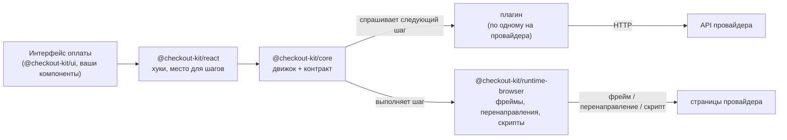
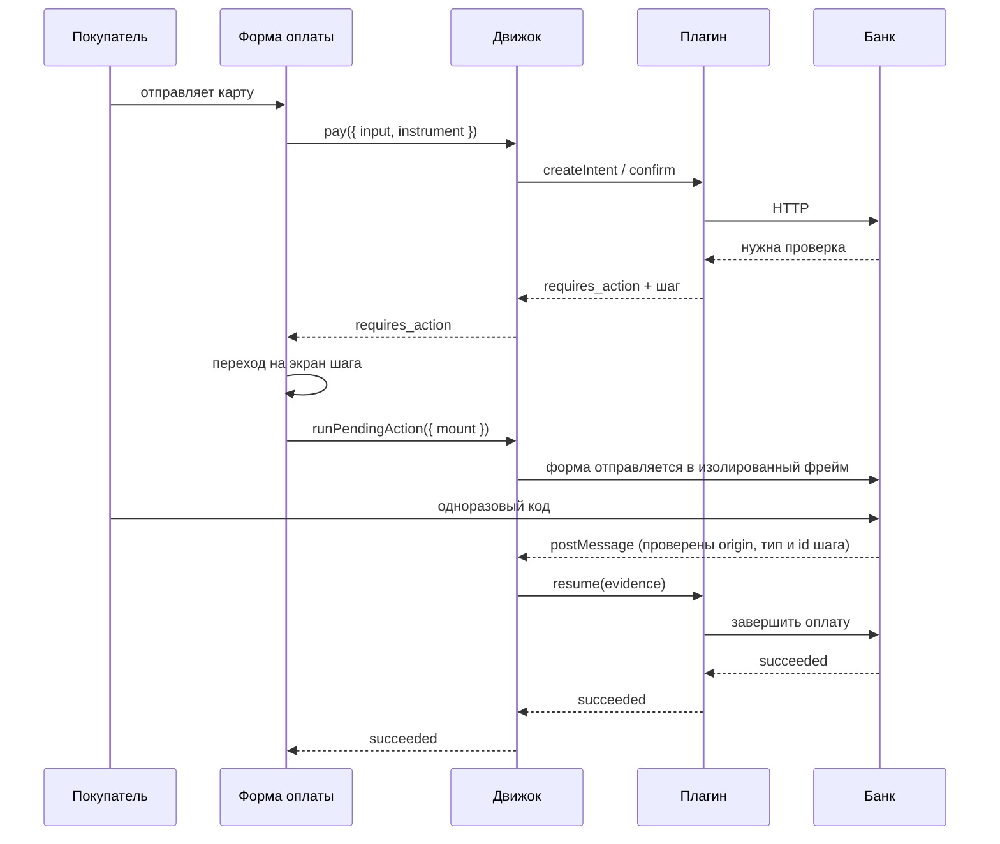
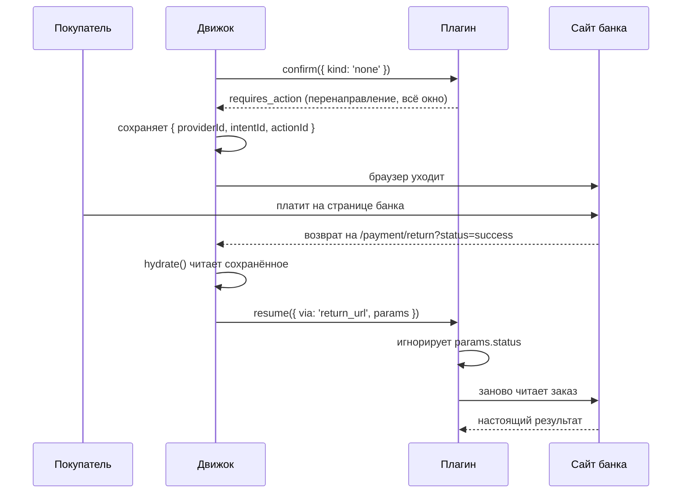

# Архитектура

> English version: [architecture.md](../architecture.md)

## Идея {#the-idea}

В коде, который принимает платежи, есть два вида знаний, и меняются они с очень разной скоростью.

**Первое — что такое платёж.** Платёж создают. Покупатель передаёт платёжный инструмент (например, токен карты). Иногда нужен ещё один шаг, например проверка банком. В конце платёж прошёл, отклонён или завершился ошибкой. Это не меняется десятилетиями.

**Второе — как всё это описывает конкретный провайдер.** JSON или HTML-формы. Статус словом или числом. Ошибка в HTTP-коде или внутри «успешного» ответа. Проверка банка во фрейме, перенаправление на страницу банка, поля карты, которые рисует провайдер, кошелёк в телефоне. Эта часть меняется часто и у каждого провайдера своя. Поэтому «добавить второго платёжного провайдера» обычно означает переписать всю оплату.

Поэтому checkout kit держит их отдельно:

- первое живёт в `@checkout-kit/core` и написано один раз;
- второе живёт в **плагинах**, по одному на провайдера. Ядро его вообще не видит.

## Один цикл, шесть видов интеграции {#one-loop-six-integrations}

```text
createIntent → confirm(instrument) → [ action → run → evidence → resume ]* → terminal
```

Это весь движок:

1. `createIntent` — создать платёж;
2. `confirm(instrument)` — передать то, чем платит покупатель;
3. если провайдер просит дополнительный шаг (`action`), раннер его выполняет (`run`), приносит то, что вернулось (`evidence`), и движок продолжает платёж (`resume`). Это может повторяться;
4. платёж приходит к окончательному статусу (`terminal`).

Между интеграциями отличаются только две вещи: **какой шаг попросил провайдер** и **какой раннер его выполняет**.

| Интеграция               | Инструмент | Первый шаг                        | Чем завершается |
| ------------------------ | ---------- | --------------------------------- | --------------- |
| Карточный процессинг     | `card`     | `redirect` во фрейм               | `post_message`  |
| Банк-эквайер             | `card`     | `redirect` с `PaReq`              | `post_message`  |
| Платёжная страница банка | `none`     | `redirect` всего окна             | `return_url`    |
| Поля карты от провайдера | `none`     | `collect_fields` во фрейме        | `post_message`  |
| Кошелёк                  | `none`     | `sdk_handoff` в скрипт кошелька   | `sdk_callback`  |
| Мгновенный перевод       | `none`     | `display` — QR-код или код оплаты | `poll`          |

В последних четырёх строках ваша страница вообще ничего не собирает. Особого случая для этого в движке нет: `{ kind: 'none' }` — обычный инструмент. Провайдер, который принимает карту в другом месте, просто сначала просит шаг.



## Пакеты {#the-packages}

**`@checkout-kit/core`** — типы платежей, контракт плагина и движок. Без React, без DOM (объектов страницы браузера), без кода под конкретный сборщик. Работает в браузере, в тестах на Node и в воркере. `npm run purity` останавливает сборку с ошибкой, если внутрь попал код, которому нужен браузер. Благодаря этому всю оплату можно прогнать в юнит-тесте, где вместо браузера — раннеры с заранее заданным сценарием.

**`@checkout-kit/runtime-browser`** — то, для чего нужен браузер: раннеры, которые отправляют формы в изолированные (sandbox) фреймы, переводят всё окно на другую страницу или загружают скрипт провайдера. Плюс один обработчик `message` на всю оплату.

**`@checkout-kit/react`** — хуки, которые читают состояние движка, и `<PaymentActionHost/>`: место на странице, где движок может показать шаг. Компонент сообщает результат обратно. Ни про какой протокол он не знает.

**`@checkout-kit/ui`** — визуальные компоненты. Обычный CSS, тема настраивается переменными `--ck-*`.

**`@checkout-kit/provider-*`** — по одному на интеграцию. Протокол провайдера живёт здесь и только здесь.

**`@checkout-kit/testing`** и **`@checkout-kit/conformance`** — поддельный платёжный сервер и набор тестов, который должен пройти каждый плагин.

## Что делает движок {#what-the-engine-does}

Кроме основного цикла, движок берёт на себя несколько вещей, в которых легко ошибиться.

**Он останавливается на шаге.** `pay` возвращает управление, как только провайдер попросил шаг, и сам его не запускает. Приложению обычно нужно сначала сменить экран или подготовить фрейм, и только потом оно вызывает `runPendingAction`. Благодаря этому перенаправление всей страницы и фрейм внутри страницы проходят через один и тот же код.

**Он сохраняет то, что уничтожит перенаправление.** Перед запуском шага id провайдера, id платежа и id шага сохраняются в session storage. При перенаправлении всей страницы она закрывается, как только отправлена форма, и без этого платёж бы потерялся. Потом `hydrate()` снова подхватывает платёж. Сначала он ждёт, пока загрузится плагин, потому что на только что открытой странице плагин может быть ещё не загружен.

**Он не доверяет тому, что вернулось.** То, что приносит раннер, показывает, где побывал браузер, а не что случилось с деньгами. Если ответ не окончательный, движок ещё раз читает платёж у провайдера и только потом что-то говорит покупателю.

**Он ждёт деньги, которые не видит.** Некоторые шаги завершаются через опрос статуса — например, QR-код или квитанция для банковского перевода. Тогда движок запускает раннер и одновременно продолжает спрашивать статус у провайдера. Кто ответит первым, останавливает другого. Поэтому покупатель всё ещё может уйти, а истёкший код останавливает опрос, а не крутит его, пока не закроют вкладку.

**Он прерывает бесконечные циклы.** Если провайдер на каждое «продолжить» отвечает новым шагом, движок останавливается после четырёх.

**Он ловит ошибки плагинов.** Плагины не должны выбрасывать исключения из `confirm` и `resume`. Но плагин — сторонний код, поэтому движок всё равно перехватывает ошибки.

Машина состояний — это таблица разрешённых переходов в отдельном файле. В ней нет промисов, провайдера и часов, поэтому каждый разрешённый и запрещённый переход проверяется маленьким юнит-тестом.

## Как проходит платёж {#how-a-payment-flows}

Оплата картой с проверкой банка во фрейме:



Платёжная страница на сайте банка, когда покупатель уходит с вашего сайта:



Запомните вторую диаграмму. `status=success` пришёл в адресе, который покупатель мог набрать вручную. Поэтому он ничего не решает.

## Где что лежит {#where-things-live}

```text
packages/
  core/                  типы, контракт, движок, http. Без React и без DOM
    src/domain/          платёж, инструмент, шаг, evidence, результат
    src/provider/        контракт плагина и его возможности
    src/engine/          машина состояний, хранилище, реестры раннеров и провайдеров
  runtime-browser/       раннеры, наблюдатели, session storage
  react/                 хуки и <PaymentActionHost/>
  ui/                    компоненты и один настраиваемый файл стилей
  provider-*/            по одному на интеграцию
  testing/               поддельный сервер, таблица карт, заглушки для тестов движка
  conformance/           набор тестов, который проходит каждый плагин

apps/
  demo/                  оплата, которая использует всё перечисленное
    src/app/providers/   точка сборки: движок, плагины, runtime
    src/features/        форма оплаты, выбор провайдера, чеки
    src/routes/          страницы, включая экран шага и страницу возврата
    e2e/                 один файл тестов, запускается для каждой интеграции
  bank-sim/              https-банк: обе версии 3-D Secure
```

Демо построено по Feature-Sliced Design и имеет своё хранилище zustand. Это хранилище только копирует состояние движка: оно подписано на движок и никогда ничего в него не пишет. Если бы два хранилища могли менять платёж, рано или поздно они бы разошлись во мнении, списаны ли деньги.

## Чего здесь нет — намеренно {#what-is-left-out-on-purpose}

**Нет отдельных команд `capture` и `refund`.** PayPal списывает деньги внутри confirm/resume. Ручное списание, возвраты и выдача заказа требуют отдельного процесса на вашем сервере, вне этого клиентского движка.

**Нет статусов `authorized` и `refunded`.** Банк-эквайер сообщает оба, но они превращаются в `processing` и `canceled`. Часть подробностей теряется намеренно: движок пользуется своим небольшим набором слов, а не банковским.

**Нет изоляции кода плагина.** Плагин работает со всеми правами страницы. Доверять плагину — значит доверять его коду.

**Ядро не принимает вебхуки.** [Пример сервера](./merchant-integration.md) обращается к API трёх провайдеров и проверяет уведомления Adyen. Настоящее состояние платежа хранит сервер, и он же сверяет платежи после закрытия браузера. Опрос статуса со стороны клиента лишь обновляет страницу оплаты, открытую прямо сейчас.

## Две недоделанные части словаря {#two-loose-ends-in-the-vocabulary}

Обе объявлены в типах, но нигде не используются. Знайте о них до того, как писать плагин:

**У `PaymentActionKind: 'poll'` нет браузерного раннера.** `@checkout-kit/runtime-browser` регистрирует `redirect`, `collect_fields`, `sdk_handoff` и `display`. Ни один готовый плагин не указывает `poll` в `capabilities.actions`, поэтому `assertCovers` не срабатывает. Но если вы, следуя таблице шагов в [plugin-authoring.md](./plugin-authoring.md), укажете `poll`, движок выбросит ошибку при запуске. Платежи, которые завершаются позже, делаются через `display` плюс собственный опрос статуса в движке; отдельный шаг `poll` сегодня в браузере выполнить нельзя.

**`ActionSurface: 'popup'` не используется.** Он есть в типе и в тестовых раннерах `@checkout-kit/testing`, и больше нигде: ни один браузерный раннер его не поддерживает и ни один плагин его не возвращает.

## Что почитать дальше {#further-reading}

- **[Как написать платёжный плагин](./plugin-authoring.md)** — тот же контракт со стороны плагина.
- **[Iframe и 3-D Secure](./iframe.md)** — как изолирована страница банка внутри вашей страницы.
- **[Заголовки безопасности](./security-headers.md)** — каждый заголовок, который отправляет симулятор банка.
- **[Поддельный платёжный API](../../packages/testing/README.md)** — адреса, машина состояний, тестовые карты, идемпотентность.
